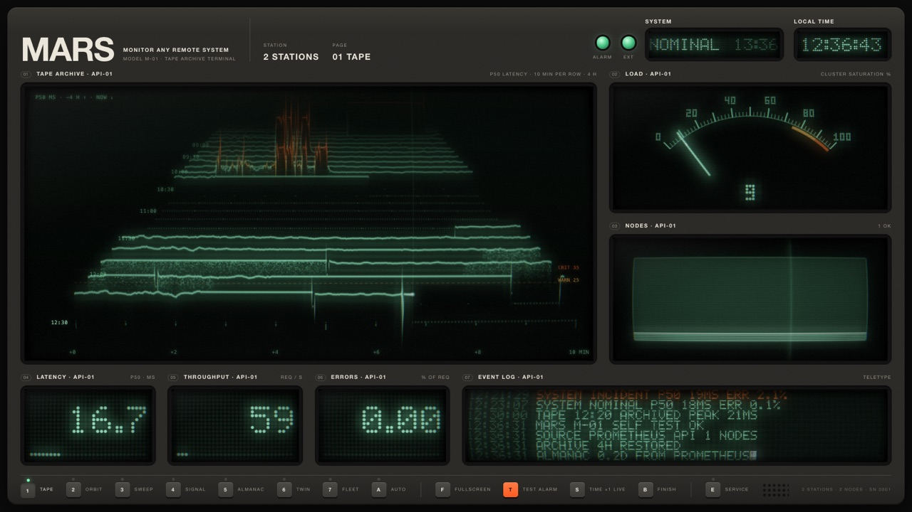
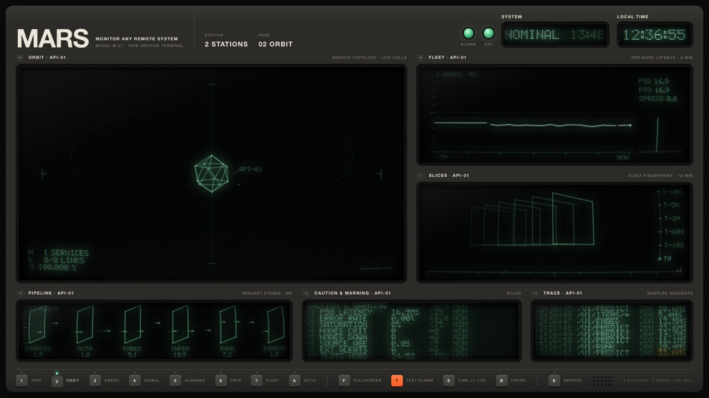
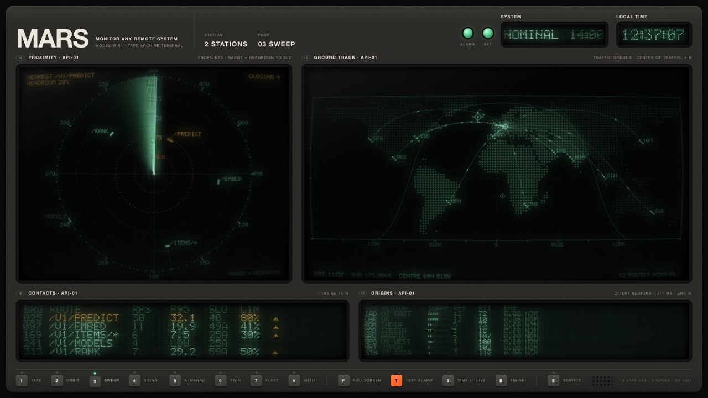
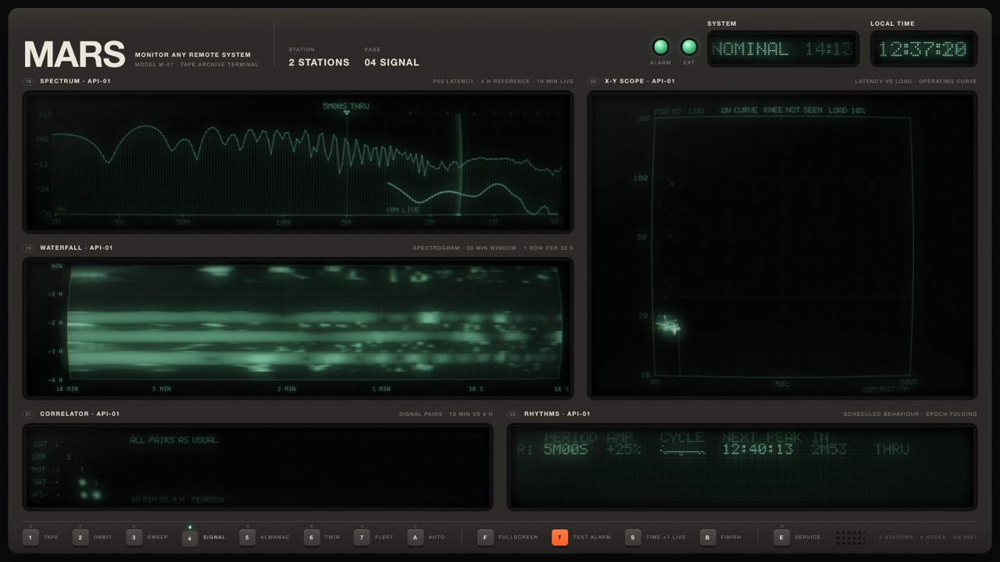
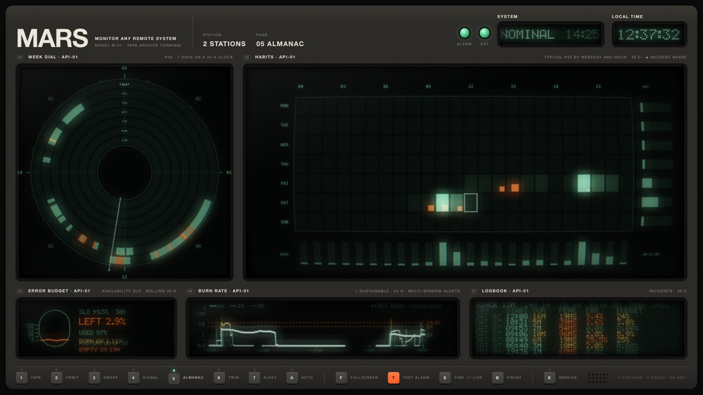
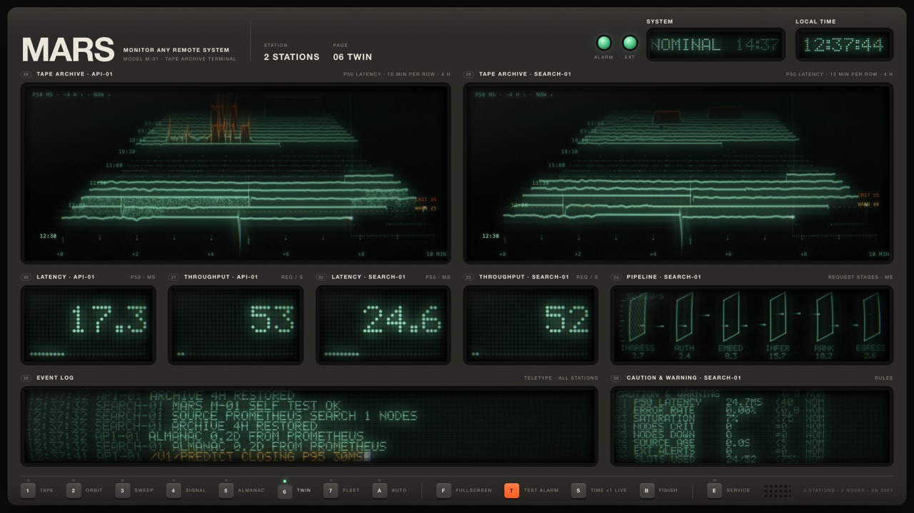
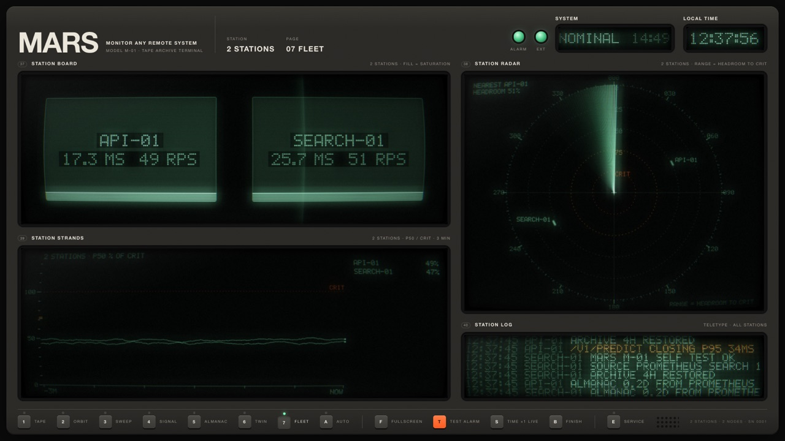

# MARS · Monitor Any Remote System

A cassette-futurist monitoring display for a spare screen: a Braun-style device whose screens
are CRT phosphor shaders, fed by the metrics of your own FastAPI servers.

```
FastAPI app + mars-probe ──push──►  mars-gateway  ──►  Prometheus           ──►  MARS web app
  (Python, probe/)          key       (gateway/)        (recording rules,          (web/)
Linux host + mars-agent  ──push──►                       deploy/)
  (agent/)                  key
```

The probe instruments a service and the agent measures a Linux host. Both push their metrics
to the display once a second with a key made on the display; the gateway checks the key and
hands the metrics to Prometheus, which pre-computes the signals the instruments need, and the
display reads them ([ADR-0010](docs/adr/0010-push-gateway.md)). Prometheus can still pull
clients that serve `/metrics` instead. Without a backend the display runs on its built-in
simulator.

## Quick start

Needs Docker with Compose v2. With Podman and `podman-compose`, run the last command as
`podman compose -f deploy/compose.yaml --profile demo build` and then `… up -d`: a single
`up --build` builds the demo image three times in parallel and can hang
([troubleshooting](deploy/README.md#troubleshooting)).

```bash
git clone https://github.com/p-sodmann/data_shaders.git mars
cd mars
docker compose -f deploy/compose.yaml --profile demo up -d --build
```

Open <http://localhost:8080> and press `F` for fullscreen. This runs Prometheus, the push
gateway, two demo stations (`api`, `search`) with a load generator, a demo host (`fleet`), and
MARS. The demo clients push with keys from the compose file. The data starts after about 15 s,
and the daily swing is compressed into 10 minutes. `docker compose -f deploy/compose.yaml
--profile demo down` stops it.

## The pages

The demo's [config document](deploy/config/mars.json) has the five standard pages for `api`, a
page for both stations and one for every station. Keys `1`–`7` switch between them, and `E`
opens the service panel for editing pages and stations.

| | |
|---|---|
| [](docs/img/page-1.jpg) **1 Tape**: four hours of P50 as a tape archive, load, nodes, the readouts and the event log | [](docs/img/page-2.jpg) **2 Orbit**: service topology, per-node latency, the request pipeline by stage, caution & warning rules, sampled requests |
| [](docs/img/page-3.jpg) **3 Sweep**: routes against their SLOs on a radar, and where the traffic comes from on a world map | [](docs/img/page-4.jpg) **4 Signal**: latency spectrum and waterfall, latency against load, correlations, rhythms such as a batch job |
| [](docs/img/page-5.jpg) **5 Almanac**: 30 days: the week dial, habits, error budget, burn rate, logbook | [](docs/img/page-6.jpg) **6 Twin**: two stations side by side on one page |
| [](docs/img/page-7.jpg) **7 Fleet**: every station at once: board, radar, strands and a shared log | |

Every instrument is described in [web/README.md](web/README.md).

## Monitor your own FastAPI server

From the cloned repo, with the demo stopped. Your app needs Python 3.11 or newer and runs as a
single uvicorn process.

1. **Install the probe** in your app's environment (it isn't on PyPI yet):

   ```bash
   pip install "mars-probe @ git+https://github.com/p-sodmann/data_shaders#subdirectory=probe"
   ```

2. **Start MARS and make a key:**

   ```bash
   docker compose -f deploy/compose.prod.yaml up -d
   ```

   Open <http://localhost:8080>, press `E`, then **Keys**. Name the key, type the station
   `hello` (lower case, digits and dashes), and press **Make key**. Copy the key: it is shown
   once.

3. **Instrument the app.** One call adds the middleware; with the two variables below it
   pushes to MARS once a second:

   ```python
   from fastapi import FastAPI
   from mars_probe import instrument

   app = FastAPI()
   instrument(app, station="hello")  # the key decides the station when pushing


   @app.get("/")
   def hello():
       return {"hello": "world"}
   ```

4. **Run it** with the display's address and the key:

   ```bash
   MARS_PUSH_URL=http://localhost:8080 MARS_PUSH_KEY=mars_… uvicorn main:app
   ```

   The app needs no port that MARS can reach, only a way out to the display. The keys plate
   lists it by its host name within a second.

5. **Add the station:** send your app a few requests, press `E`, then **Stations**: `hello` is
   listed under *Available on Prometheus*. **Add** puts it on the device, together with its
   five standard pages if you like.

To let Prometheus pull instead, leave the variables out, run the app where Prometheus can
reach it (`--host 0.0.0.0`) and add a target file:
`mars-probe scrape-config --target host.docker.internal:8000 > deploy/site/targets/hello.yml`.

## Monitor a fleet of Linux hosts

New to all of this? The [step-by-step tutorial](docs/tutorial-linux-fleet.md) starts from
installing Docker. The short version:

Make a key for the station `fleet` on the display (`E` → **Keys**), run
[mars-agent](agent/README.md) with it on every host, and load the fleet example:

```bash
# on each host, in a checkout of this repo
printf 'MARS_PUSH_URL=http://mars.lan:8080\nMARS_PUSH_KEY=mars_…\n' > agent/.env
docker compose -f agent/compose.yaml up -d
```

Then open <http://localhost:8080/?config=/examples/linux-fleet.json>. Each host is a node of
station `fleet`: a lamp, a strand and a slice. The latency slot shows how long work waits for a
CPU, throughput is packets per second, errors are memory stalls, and load is the fullest of CPU,
memory and disk ([ADR-0009](docs/adr/0009-linux-hosts.md)). The demo stack runs one agent too,
so the example works there as well.

Stages, custom signals and client regions are in [probe/README.md](probe/README.md). Several
servers, a shared config for all displays, basic auth and the security notes are in
[deploy/README.md](deploy/README.md). A Raspberry Pi as a wall display:
[deploy/KIOSK.md](deploy/KIOSK.md).

## Repository

```
web/            MARS display (Vite + React + WebGL2)        → web/README.md
probe/          mars-probe Python package                   → probe/README.md
agent/          mars-agent: Linux hosts as fleet nodes      → agent/README.md
gateway/        mars-gateway: push keys, pushes → Prometheus → gateway/README.md
examples/demo/  demo FastAPI service + load generator       → examples/demo/README.md
deploy/         Docker Compose, Prometheus config, kiosk    → deploy/README.md, deploy/KIOSK.md
scripts/        check.sh (every check), build-images.sh     
docs/           plan: steps, ADRs, open questions           → docs/README.md
```

Without Docker: `cd web && npm i && npm run dev` runs the display on its simulator; the demo
service runs with `uv` ([examples/demo/README.md](examples/demo/README.md)).

## Develop

```bash
scripts/check.sh
```

runs every check, the same as CI: probe tests and lint, the promtool rule tests, agent, gateway and demo tests,
web unit tests and build, the headless smoke test, and the compose files. It needs `uv`,
Node 22, and Docker or Podman (or a local `promtool`). Releases: [CHANGELOG.md](CHANGELOG.md);
a `v*` tag builds the multi-arch images and the probe wheel.

- [docs/README.md](docs/README.md): the step table and the rules for implementing a step
- [docs/adr/](docs/adr/): architecture decisions (binding contracts)
- [docs/open-questions.md](docs/open-questions.md): what is still undecided

MIT licensed, see [LICENSE](LICENSE).
