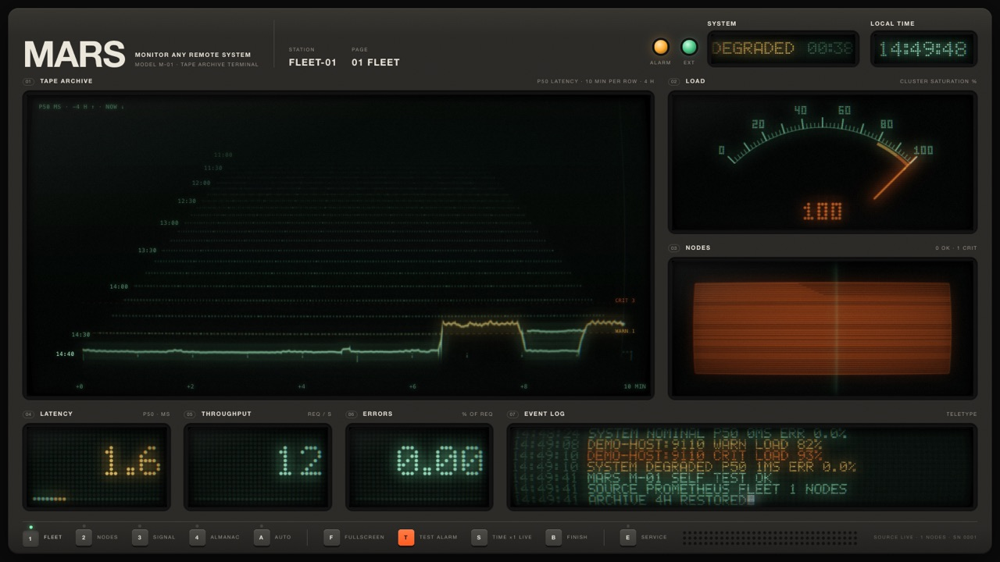
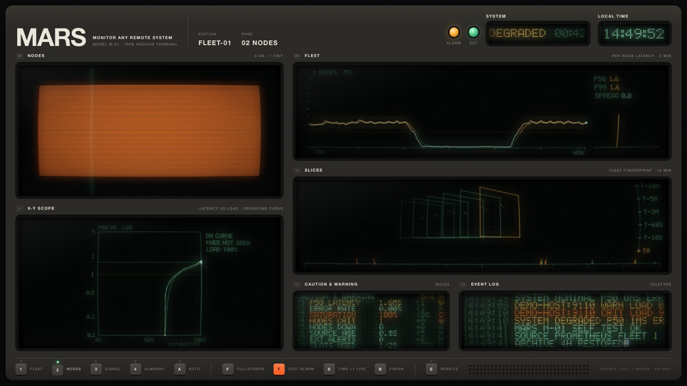

# Tutorial: watch your Linux computers on MARS

This guide takes you from nothing to a screen that shows how your Linux computers are doing:
a lamp for each computer, a tape that remembers the last four hours, and a needle that shows
how busy they are. You don't need to know how any of it works inside. Copy the commands
exactly, one at a time, and check each step before moving on.

It takes about 30 minutes the first time, most of it waiting for downloads.



---

## The idea in one minute

There are two kinds of computer in this guide:

- **The computers you want to watch.** We call them *hosts*. They must run Linux (Ubuntu,
  Debian, Fedora, Raspberry Pi OS…). Each one gets a small helper program, **mars-agent**, that
  measures how busy the computer is.
- **The display computer.** This one runs **MARS**, the screen with the lamps and the needle.
  It can be a Mac, a Linux PC or a Raspberry Pi. Every host sends it its numbers once a second,
  and it draws them.

A host proves it may send numbers with a **key**: a long password that you make on the display
in step 5 and give to the agent in step 6. The hosts call the display, never the other way
round, so the hosts need no open ports and you don't have to collect their addresses.

The display computer can also be one of the hosts. That's fine, and step 6 says what to do then.

All the hosts together are called the **fleet**. Each host is one **node** of the fleet.

---

## Before you start: what you need

- [ ] The display computer, connected to the same network (Wi-Fi or cable) as the hosts.
- [ ] Each host switched on and connected to that network.
- [ ] A way to type commands on every one of these computers (step 1 shows how).
- [ ] The password of a user that may install software on each computer (an *administrator*,
      the one that works with `sudo`).
- [ ] A piece of paper for the display computer's address. You'll need it in step 4.

---

## Step 1: open a terminal

A *terminal* is a window where you type commands instead of clicking. Every command in this
guide goes there. Type it (or paste it), then press **Enter**.

- **On a Mac:** press **⌘ Cmd + Space**, type `Terminal`, press **Enter**.
- **On a Linux computer with a screen:** press **Ctrl + Alt + T**, or look for *Terminal* in
  the app menu.
- **On a Linux computer without a screen** (a server in a cupboard): log in to it from another
  computer's terminal with

  ```bash
  ssh yourname@192.168.1.50
  ```

  Replace `yourname` with your user name on that computer and `192.168.1.50` with its address
  (step 4 shows how to find the address). Type `yes` if it asks whether to continue, then your
  password. You're now typing on that computer. `exit` takes you back.

**Good to know:**

- When you type a password in the terminal, **nothing appears on screen**, not even dots.
  That's normal. Type it and press Enter.
- To paste into a Linux terminal, use **Ctrl + Shift + V** (plain Ctrl + V doesn't work there).
  On a Mac it's **⌘ Cmd + V**.
- If a command seems stuck, wait a minute: downloads can be slow. **Ctrl + C** stops it.
- Lines that start with `#` in the boxes below are notes for you. You don't have to type them.

---

## Step 2: install Docker and Git on every computer

**Docker** runs MARS and the agent in neat boxes so you don't have to install anything else.
**Git** downloads the MARS files.

Do this on **every** computer: every host and the display computer.

### On Linux (Ubuntu, Debian, Raspberry Pi OS, Fedora…)

1. Install Docker with its official installer:

   ```bash
   curl -fsSL https://get.docker.com | sudo sh
   ```

   It asks for your password, then runs for a minute or two.

   If it says `curl: command not found`, first run `sudo apt install -y curl` (or
   `sudo dnf install -y curl` on Fedora) and try again.

2. Install Git:

   ```bash
   # Ubuntu, Debian, Raspberry Pi OS:
   sudo apt install -y git
   # Fedora:
   sudo dnf install -y git
   ```

3. Check that both work:

   ```bash
   sudo docker compose version
   git --version
   ```

   ✅ You should see two lines with version numbers, such as `Docker Compose version v2.29.1`
   and `git version 2.43.0`. The exact numbers don't matter.

### On a Mac (only if the display computer is a Mac)

1. Download **Docker Desktop** from <https://www.docker.com/products/docker-desktop/>, open the
   downloaded file, and drag Docker into *Applications*.
2. Start **Docker** from *Applications*. Wait until the whale icon at the top of the screen
   stops moving.
3. In the terminal, type `git --version`. If a window offers to install the *command line
   developer tools*, click **Install** and wait for it to finish.
4. Check:

   ```bash
   docker compose version
   git --version
   ```

> **On a Mac, leave out `sudo`.** Everywhere this guide writes `sudo docker …`, a Mac user
> types just `docker …`.

---

## Step 3: download MARS on every computer

Do this on **every** computer again. It puts a folder called `mars` in your home folder:

```bash
cd ~
git clone https://github.com/p-sodmann/data_shaders.git mars
cd mars
```

✅ `ls` now lists folders such as `agent`, `deploy` and `web`.

From now on, **every command runs inside this `mars` folder**. If you open a new terminal
later, type `cd ~/mars` first.

---

## Step 4: start MARS on the display computer

On the **display computer**:

```bash
cd ~/mars
sudo docker compose -f deploy/compose.prod.yaml up -d --build
```

The first time this takes a few minutes (it downloads and builds the display). At the end it
says that `mars-prod-prometheus-1`, `mars-prod-mars-gateway-1` and `mars-prod-mars-1` have
started. MARS starts by itself whenever the display computer restarts.

1. Find the display computer's address and **write it on your paper**:

   ```bash
   # Linux:
   hostname -I
   # Mac:
   ipconfig getifaddr en0
   ```

   On Linux, the first group of four numbers is the address, for example `192.168.1.20`.
   Ignore anything after the first space.

2. Is there a firewall on the display computer? On Linux, check:

   ```bash
   sudo ufw status
   ```

   - If it says `Status: inactive` or `command not found`, there's nothing to do.
   - If it says `Status: active`, let the hosts in. This allows every computer on a home
     network that starts with `192.168.1.`; change it to match your address:

     ```bash
     sudo ufw allow from 192.168.1.0/24 to any port 8080 proto tcp
     ```

   On a Mac, if macOS asks whether Docker may accept incoming connections, click **Allow**.

---

## Step 5: make a key for your fleet

Still on the **display computer**, open a web browser and go to:

```
http://localhost:8080
```

1. Press **E** on the keyboard. The service panel opens on the right.
2. Click the **K** key labelled **Keys**. The *Push keys* plate opens.
3. Under *New key*, type a **Name** you'll recognise, for example `my computers`, and press
   **Enter**.
4. In **Station**, type `fleet` and press **Enter**. (*Station* is the group your computers
   show up in. The example layout in step 8 reads `fleet`.)
5. Click **Make key**.

✅ A box appears with a long key starting with `mars_`, and the words *shown once · copy it
now*. Click **Copy key** and paste it somewhere safe, or write it on your paper. **MARS shows
this key only this once.** If you lose it, make a new one; nothing breaks.

All your hosts can use this one key. Leave the page open; you'll watch the hosts arrive here
in step 7.

---

## Step 6: start the agent on every host

Do this on **each host** (each computer you want to watch). Skip the display computer, unless
it should be watched too.

1. Check that this host can reach the display computer. Replace `192.168.1.20` with the
   address on your paper:

   ```bash
   curl -s http://192.168.1.20:8080/healthz
   ```

   ✅ It answers `ok`. ❌ If it says `Connection refused`, waits for a long time or prints
   nothing, see [A host doesn't show up](#a-host-doesnt-show-up).

2. Tell the agent where to send its numbers and which key to use. Open a new file in a simple
   text editor called *nano*:

   ```bash
   cd ~/mars
   nano agent/.env
   ```

   Type these two lines, with **your** display address and **your** key:

   ```
   MARS_PUSH_URL=http://192.168.1.20:8080
   MARS_PUSH_KEY=mars_PASTE-YOUR-KEY-HERE
   ```

   No spaces around the `=`. Save and close nano: press **Ctrl + O**, then **Enter** (that
   saves), then **Ctrl + X** (that closes).

   **If the display computer is also a host** (you're doing step 6 on it), write
   `MARS_PUSH_URL=http://localhost:8080` instead.

3. Start the agent:

   ```bash
   sudo docker compose -f agent/compose.yaml up -d --build
   ```

   The first time this downloads and builds for a minute or two. At the end it says something
   like `Container mars-agent-mars-agent-1  Started`.

4. Check that it sends:

   ```bash
   sudo docker compose -f agent/compose.yaml logs
   ```

   ✅ The last line reads `mars-agent: pushing to http://192.168.1.20:8080/push/…`, ending in
   this host's name.

The agent now starts by itself whenever the host restarts, and it remembers the address and
the key (they're in `agent/.env`). You never have to start it again.

**Repeat step 6 on every host** before going on.

---

## Step 7: check that MARS sees every host

Back on the **display computer**, look at the *Push keys* plate from step 5 (press **E**, then
**Keys**, if you closed it).

✅ Your key's row shows a green lamp, and under it the names of your hosts. *Nodes* counts
them: `3/3` means three hosts, all sending. *Push* says how long ago the last numbers came,
normally `0 s` or `1 s`.

A host that is missing hasn't sent anything yet: see
[A host doesn't show up](#a-host-doesnt-show-up). Press **Esc** to close the service panel.

---

## Step 8: open the display

On the display computer, open a web browser and go to:

```
http://localhost:8080/?config=/examples/linux-fleet.json
```

✅ You see the MARS device with **FLEET-01** at the top and four pages: **Fleet**, **Nodes**,
**Signal**, **Almanac**. The tape starts filling in after a few seconds.

Useful keys:

| Key | What it does |
|---|---|
| **1** – **4** | switch between the four pages |
| **F** | full screen (press again or **Esc** to leave) |
| **A** | flip through the pages by itself |
| **E** | the service panel, to change things; **Esc** closes it |

### Make it the start page (optional)

So that `http://localhost:8080` opens the fleet straight away, without the long address:

```bash
cd ~/mars
cp web/public/examples/linux-fleet.json deploy/site/config/mars.json
```

Then open `http://localhost:8080` in a **new private window** to check. A browser that opened
MARS before keeps the layout it remembered. To make it load the new start page, delete what it
stored for this site: in Chrome, click the icon left of the address, then *Site settings* →
*Delete data*. Or simply keep using the long address.

### Watch from another computer, tablet or TV

Any device on the same network can open the display. Use the display computer's address
instead of `localhost`, for example `http://192.168.1.20:8080/?config=/examples/linux-fleet.json`.

---

## Step 9: reading the screen



**Colours mean something, and only these three:**

- **Mint green:** all fine.
- **Amber (yellow-orange):** worth a look. Something is getting busy.
- **Orange-red, blinking:** a problem right now.

**The Fleet page (key 1)**

| Panel | What it tells you |
|---|---|
| **Tape archive** (big, left) | How long programs had to wait for a free processor, over the last four hours. Each row is 10 minutes, the newest at the front. A flat line near the bottom is a calm fleet; humps are busy times. Lines at the same place in several rows mean something happens on a schedule, like a nightly backup. |
| **Load** (needle) | How full the busiest computer is, in %. Full means its processor, memory **or** disk is nearly used up, whichever is worst. |
| **Nodes** (lamps) | One lamp per computer. The fill level is how full it is; the colour is its state. A dark lamp with a line through it means that computer isn't answering (switched off, or the agent stopped). |
| **Latency** (number) | Wait for a free processor right now, in milliseconds. Under 1 is calm. Above 3 the computers are overloaded. |
| **Throughput** (number) | Network packets per second, in and out, of all computers together. It only says how much traffic there is; it isn't good or bad. |
| **Errors** (number) | How much of the time a program was stuck waiting for memory, in %. 0.00 is what you want. |
| **Event log** | Short typed messages when something changes, like *DEMO-HOST:9110 WARN LOAD 82%*. |

**The Nodes page (key 2)** shows each computer separately: big lamps, a line per computer for
the last 3 minutes (a computer in trouble *peels away* from the bundle), and snapshots of the
last 10 minutes stacked like film frames.

**Signal (key 3)** finds things that repeat, like a job every hour. It needs about two hours of
data before it shows much.

**Almanac (key 4)** remembers 30 days: which weekdays and hours are busy. It fills up over
days.

> The panel titles still say *P50 latency* and *req / s*, because MARS was first made for web
> services. For your computers, read them as described above.

---

## When something goes wrong

### `permission denied` when running a `docker` command

You left out `sudo` on Linux. Put `sudo ` in front of the command and run it again.

### `Cannot connect to the Docker daemon`

Docker isn't running. On Linux: `sudo systemctl start docker`. On a Mac: start **Docker** from
*Applications* and wait for the whale icon to stop moving.

### `no such file or directory` for `agent/compose.yaml` or `deploy/…`

You're not in the `mars` folder. Type `cd ~/mars` and run the command again.

### A host doesn't show up

On that host, look at what the agent says:

```bash
cd ~/mars
sudo docker compose -f agent/compose.yaml logs
```

- **`401: the gateway doesn't know this key`**: the key in `agent/.env` is wrong (a typo, a
  missing character) or was revoked. Copy it again, or make a new one (step 5), fix
  `agent/.env`, and run `sudo docker compose -f agent/compose.yaml up -d` again.
- **`Connection refused`, `timed out` or `Name or service not known`**: the host can't reach
  the display computer.
  1. Is MARS running there? On the display computer: `sudo docker compose -f
     deploy/compose.prod.yaml ps`. All three should say `Up`.
  2. Is the address right? Run `hostname -I` on the display computer again. Did it change?
     Home routers sometimes hand out new addresses. In your router's settings you can give the
     display computer a fixed one (often called *DHCP reservation*).
  3. Firewall on the display computer: see step 4, point 2.
  4. Are both computers on the same network? A guest Wi-Fi often can't reach the main network.
- **It says `serves /metrics` instead of `pushing to`**: the agent didn't find `agent/.env`.
  Check that the file is in `~/mars/agent/` and is called exactly `.env` (`ls -a agent`).

### A lamp is dark with a line through it

That computer stopped sending: it's switched off, asleep, off the network, its agent stopped,
or its key was revoked. Switch it on or run step 6 on it again. The lamp comes back on its own
within a few seconds.

A computer you removed for good also stays dark until you reload the page (**F5**).

### The tape and the latency number stay empty, but the lamps work

On that host, look at what the agent says when it starts:

```bash
sudo docker compose -f agent/compose.yaml logs
```

If it says `can't read schedstat`, that computer's Linux doesn't offer the wait measurement.
The lamps and the needle still work. This is rare; most current Linux versions have it.

### The needle sits high although nothing is happening

The needle shows the fullest of processor, memory **and disk**. A disk that is 85 % full keeps
it there. Check with `df -h /` on each host. That is a real warning: free some space.

### The screens stay dark, say NO SIGNAL, or the station's lamp is struck through (STALE)

The display isn't getting data. First check that the address you opened ends in
`?config=/examples/linux-fleet.json` (step 8). Then, on the display computer:

```bash
cd ~/mars
sudo docker compose -f deploy/compose.prod.yaml ps
```

`mars`, `mars-gateway` and `prometheus` should all say `Up`. If not, run step 4 again. If
they are up, check the keys plate (step 7): it must list your hosts.

---

## Everyday tasks

**Add a computer to the fleet:** do steps 2, 3 and 6 on it, with the same key. It appears as
a new lamp within a few seconds, no reload needed.

**Remove a computer:** on that computer, stop the agent:

```bash
cd ~/mars
sudo docker compose -f agent/compose.yaml down
```

**A key got out** (you pasted it somewhere public, or a computer was stolen): make a new key,
put it in `agent/.env` on every host and run `sudo docker compose -f agent/compose.yaml up -d`
there, then revoke the old key on the keys plate: press **✕** on its row twice. Computers still
using the old key go dark at once. To be able to cut off one computer alone, give each
computer its own key.

**Update to a newer version of MARS:** on each computer,

```bash
cd ~/mars
git pull
# on hosts:
sudo docker compose -f agent/compose.yaml up -d --build
# on the display computer:
sudo docker compose -f deploy/compose.prod.yaml up -d --build
```

**Switch everything off:** on the display computer,
`sudo docker compose -f deploy/compose.prod.yaml down`. The history is kept and comes back
when you start it again.

---

## Going further

- Change when lamps turn amber or red: press **E**, then the **Stations** key, then the **✎**
  key next to **FLEET-01**, and change its *Thresholds*. The example starts with: wait warn 1 ms / critical 3 ms, memory stalls 2 % /
  10 %, fullness 80 % / 92 %.
- Several fleets (for example *web* and *database* computers): make a second key with the
  station `db` (step 5), use it in `agent/.env` on the database computers, and add the station
  `db` in the service panel (**E** → **Stations**, where it is listed under *Available* once
  its computers send).
- A Raspberry Pi as a wall display that starts by itself: [deploy/KIOSK.md](../deploy/KIOSK.md).
- Password protection for the display: [deploy/README.md](../deploy/README.md#security).
- How the agent measures, in detail: [agent/README.md](../agent/README.md) and
  [ADR-0009](adr/0009-linux-hosts.md). How keys and pushing work:
  [gateway/README.md](../gateway/README.md) and [ADR-0010](adr/0010-push-gateway.md).
